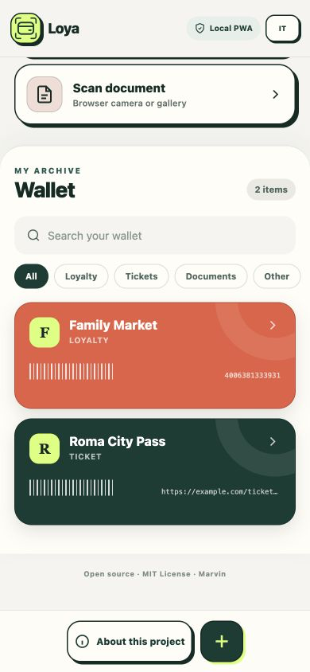
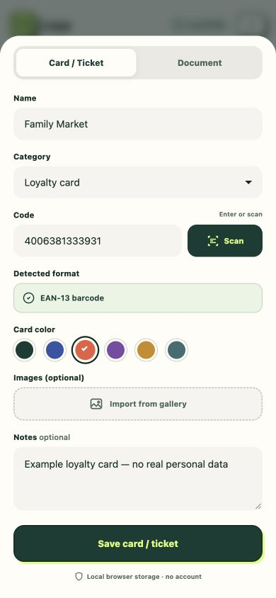
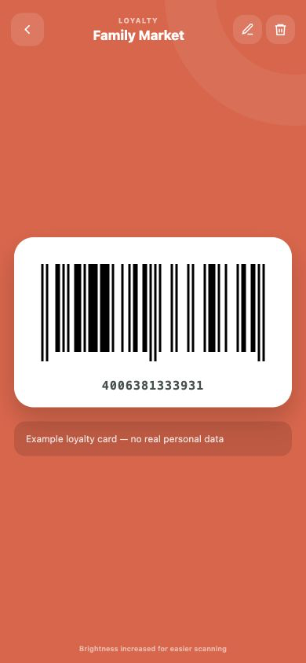
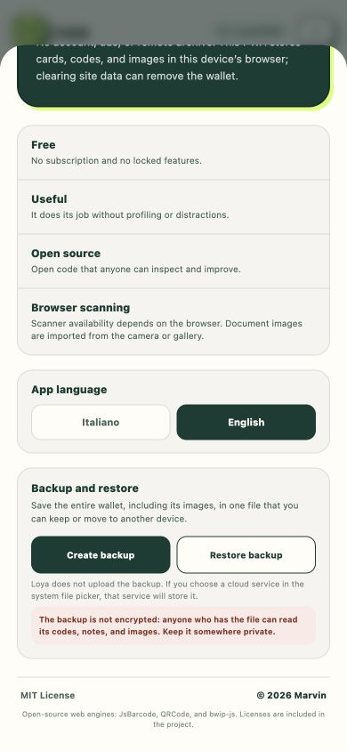

# Loya

**Loya — the digital wallet that can contain everything.**

Keep loyalty cards, tickets, barcodes, QR codes, notes, and document images together on your own device. Loya has no advertising, no Loya account, and no developer-operated wallet cloud.

<table>
  <tr>
    <td align="center"> <strong>Your wallet</strong></td>
    <td align="center"> <strong>Add a card or ticket</strong></td>
  </tr>
  <tr>
    <td align="center"> <strong>Open a scannable code</strong></td>
    <td align="center"> <strong>Back up or move everything</strong></td>
  </tr>
</table>

The names and codes in these screenshots are invented examples. They do not belong to a real person or business.

## I just want Loya: which version should I choose?

You do **not** need a GitHub account. You do **not** need a computer, a cable, or an app store.

| Your device | Choose this version |
| --- | --- |
| Samsung, Pixel, Motorola, Xiaomi, OnePlus, or another Android phone with the Google Play Store | **Google APK** |
| GrapheneOS, a de-Googled phone, or any Android device where you do not want Google scanner services | **Offline APK** |
| iPhone or iPad | **PWA** |
| Windows, macOS, Linux, or Chromebook | **PWA** |
| You are still unsure and you have an Android phone | **Google APK** |

### Recommended for ordinary Android phones: Google APK

This version uses Google ML Kit and Google Play services for the best document-scanning experience. Codes are recognized on the device, but Google Play services may use the Internet to obtain or update scanner components.

**[Download Loya – Google](https://github.com/MarvinBonazzo/loya/releases/latest/download/Loya-Google-v3.2.0.apk)**

### No Google scanner services: Offline APK

This version uses the open-source ZXing and OpenCV engines. Barcode recognition and document correction happen locally, and the APK is built without Android's Internet permission.

**[Download Loya – Offline](https://github.com/MarvinBonazzo/loya/releases/latest/download/Loya-Offline-v3.2.0.apk)**

There is also a smaller Offline build for modern ARM64 phones. Use it only if the normal Offline APK is too large or will not install:

**[Download the smaller ARM64 Offline APK](https://github.com/MarvinBonazzo/loya/releases/latest/download/Loya-Offline-v3.2.0-arm64.apk)**

If you do not know what ARM64 means, ignore that smaller file and use the normal Offline APK.

### No APK: PWA for phones, tablets, and computers

A PWA is a website that can be installed like an app. Open it here:

**[Open Loya in your browser](https://marvinbonazzo.github.io/loya/)**

Ordinary users should open that page; they do not need the ZIP file. A portable copy of the PWA files is also attached to the latest release:

**[Download the Loya PWA package](https://github.com/MarvinBonazzo/loya/releases/latest/download/Loya-PWA-v3.2.0.zip)**

All downloadable files are on the **[latest Loya release page](https://github.com/MarvinBonazzo/loya/releases/latest)**. If a large link above says **Not Found**, open the release page and tap the file with the same name.

The Google and Offline APKs are two editions of the same Android app. They use the same app identity and **cannot be installed side by side**. Install one.

## Install an APK on Android, one tap at a time

These instructions work for both Android editions.

1. Open this page on the Android phone where you want Loya.
2. Tap **Download Loya – Google** or **Download Loya – Offline** above.
3. The download may start immediately. If GitHub shows a release page first, tap the APK filename there.
4. Before accepting a warning, make sure you began from this README or the official `MarvinBonazzo/loya` release page. GitHub may redirect the actual file through its download service.
5. If you began from the official page, tap **Download anyway**, **Keep**, or the similar button shown by your phone.
6. Wait until the download finishes.
7. Tap the finished-download notification.
8. If the notification disappeared, open the phone's **Files**, **My Files**, or **Downloads** app.
9. Open the **Downloads** folder.
10. Tap the file whose name starts with `Loya-Google` or `Loya-Offline` and ends with `.apk`.
11. If Android says this source is not allowed to install apps, tap **Settings**.
12. Turn on **Allow from this source** for the browser or file app you are using.
13. Go back once.
14. Tap **Install**.
15. When Android says the app is installed, tap **Open**.
16. If Loya asks to use the camera, tap **While using the app** or **Allow**. The camera is needed only when you choose to scan something.

You may turn off the temporary installation permission afterward:

1. Open Android **Settings**.
2. Open **Apps**.
3. Open **Special app access**. On some phones it is inside the three-dot menu.
4. Open **Install unknown apps**.
5. Choose the browser or file app used for installation.
6. Turn off **Allow from this source**.

Only install an APK downloaded from this repository's release page. Do not install a copy sent by a stranger or found on a different website.

## Install the PWA on Android

1. Open **Google Chrome**.
2. Open **[Loya](https://marvinbonazzo.github.io/loya/)**.
3. Wait until the page has completely appeared.
4. Tap Chrome's three-dot menu in the upper-right corner.
5. Tap **Install app**. If that is not shown, tap **Add to Home screen**.
6. Tap **Install** or **Add**.
7. Return to the phone's home screen.
8. Find the Loya icon and tap it.
9. Allow camera access if you want to scan codes.

## Install the PWA on iPhone or iPad

Use Safari. The required option may be hidden when the page is opened inside Gmail, Facebook, Instagram, or another app.

1. Open the **Safari** app.
2. Open **[Loya](https://marvinbonazzo.github.io/loya/)**.
3. Tap Safari's **Share** button. It looks like a square with an arrow pointing upward.
4. Scroll down through the Share menu.
5. Tap **Add to Home Screen**.
6. Tap **Add** in the upper-right corner.
7. Return to the home screen.
8. Find the Loya icon and tap it.
9. Allow camera access if Safari asks.

If **Add to Home Screen** is missing, copy the link, open Safari yourself, paste the link into Safari's address bar, and repeat the steps.

## Install the PWA on a computer

On Windows, macOS, Linux, or Chromebook, use current Google Chrome or Microsoft Edge and follow the matching instructions below.

### Google Chrome

1. Open **[Loya](https://marvinbonazzo.github.io/loya/)** in Chrome.
2. Look at the right side of the address bar for an install icon. It may look like a small computer with a downward arrow.
3. Click that icon.
4. Click **Install**.
5. If there is no icon, open Chrome's three-dot menu.
6. Open **Cast, save, and share** or **Save and share**.
7. Click **Install page as app**.

### Microsoft Edge

1. Open **[Loya](https://marvinbonazzo.github.io/loya/)** in Edge.
2. Click the three-dot menu in the upper-right corner.
3. Click **Apps**.
4. Click **Install Loya** or **Install this site as an app**.
5. Click **Install**.

You can also use Loya as an ordinary website without installing it.

## A simple example: add a loyalty card

1. Open Loya.
2. Tap the green **+** button at the bottom.
3. Keep **Card / Ticket** selected.
4. Type a name, such as `My supermarket`.
5. Keep **Loyalty card** selected.
6. Tap **Scan** and point the camera at the code, or type the printed number into the **Code** box.
7. Optionally choose a color, add an image, or write a note.
8. Tap **Save card / ticket**.
9. The card now appears in the wallet.
10. Tap it whenever you need to show its code.

## A simple example: save a ticket

1. Tap the green **+** button.
2. Enter a clear name, such as `Train to Rome`.
3. Choose **Ticket / transport**.
4. Scan the QR, Aztec, PDF417, or barcode on the ticket. Scanning is important when the exact visual code format must be preserved.
5. Add a note such as the travel date if useful.
6. Tap **Save card / ticket**.

## A simple example: save a document image

1. Tap the large **Scan document** button, or tap **+** and choose **Document**.
2. Choose the type of document or enter a name.
3. On Android, use the document scanner and follow the instructions on screen.
4. In the PWA, take or choose a clear photo when the browser opens the camera or gallery.
5. Check the preview.
6. Tap **Save document**.

Loya is a convenient personal archive, not a government identity system. A saved picture does not replace a legally required original document.

## Every code format Loya recognizes

Both Android APKs scan these **13 formats**:

| Format | Common example |
| --- | --- |
| Code 128 | Membership cards, shipping labels, general identifiers |
| Code 39 | Industrial and older membership labels |
| Code 93 | Compact industrial or inventory labels |
| Codabar | Older library, laboratory, and logistics labels |
| EAN-13 | Retail products and many loyalty cards |
| EAN-8 | Small retail products |
| ITF | Cartons, packaging, and numeric identifiers |
| UPC-A | North American retail products |
| UPC-E | Compact North American retail products |
| QR Code | Tickets, passes, links, and general data |
| PDF417 | Travel documents, tickets, and large structured data |
| Aztec | Train and airline tickets |
| Data Matrix | Very small labels and compact structured data |

The PWA asks the browser for the same 13 formats, but the browser decides which ones are actually available. If a PWA camera scan does not work, type or paste the code, or use one of the Android APKs.

Manual typing or pasting always saves the value, but it cannot reliably identify whether that value originally came from a QR Code, Aztec, PDF417, Code 93, Codabar, or another format. It may therefore display a different scannable format. Use camera scanning—preferably an Android APK—when a machine must read the exact original symbology.

Important distinctions:

- Importing a picture attaches that picture to the saved item; it does **not** decode a barcode from the picture.
- Loya does not read magnetic stripes, NFC payment chips, or contactless bank cards.
- Loya can store an image of a document, but it does not verify the document's legal validity.

## Create a complete backup

A Loya backup contains all saved items, codes, notes, and supported images in one file. You can move that file to another phone or computer and restore it in another Loya APK or PWA installation.

1. Open Loya.
2. Tap **About this project** at the bottom.
3. Find **Backup and restore**.
4. Tap **Create backup**.
5. Your device asks where to save the file, or saves it in **Downloads**.
6. If asked, choose a private folder that you will remember.
7. Tap **Save**.
8. Look for a file named like `loya-backup-YYYY-MM-DD.json`. The letters are replaced by the date when you create it; for example, a backup made on 18 July 2026 is named `loya-backup-2026-07-18.json`.
9. Keep that file somewhere safe.

The backup is **not encrypted**. Anyone who gets the file can read its codes, notes, and images. Do not post it on GitHub, attach it to a public issue, or send it to someone you do not trust.

Loya does not upload a backup by itself. However, if you choose Google Drive, iCloud Drive, Dropbox, OneDrive, or another cloud folder in the system file picker, that service will receive and store the file.

One backup file can contain up to 1,000 items, 2,000 images, and 64 MiB of data. Loya reduces large scanner images when preparing the file. If the wallet is still too large, Loya shows an error and does not alter the live wallet; remove unneeded images and try again. A large Android backup may also exceed the storage available to a PWA browser.

## Restore a backup on this or another device

Restoring is a **replace**, not a merge. The wallet currently open in Loya will be replaced by the wallet inside the backup.

1. Put the Loya backup file on the new device. Sending it to yourself privately or copying it with a cable is fine.
2. Install or open Loya on that device.
3. Tap **About this project**.
4. Find **Backup and restore**.
5. Tap **Restore backup**.
6. Choose the file whose name begins with `loya-backup-` and ends with `.json`.
7. Loya shows how many items and images are inside.
8. Read the warning.
9. If you want to continue, tap **Replace**.
10. Wait for the success message.
11. Open a few cards and images to confirm they are present.

If the file is invalid, unsupported, damaged, or too large, Loya refuses it and keeps the current wallet.

There is no automatic synchronization. Create a new backup whenever you make important changes.

## Change the language

Italian is the default language. English is included.

Fast method:

1. Open Loya.
2. Tap **EN** near the upper-right corner to switch to English.
3. Tap **IT** in the same place to return to Italian.

Full menu:

1. Tap **About this project** at the bottom.
2. Find **App language**.
3. Tap **Italiano** or **English**.

Loya remembers the choice on that device or in that browser.

## Update Loya without losing your wallet

Create a backup before every important update.

### Update an Android APK

1. Open the **[latest release page](https://github.com/MarvinBonazzo/loya/releases/latest)** on the phone.
2. Download the same edition you already use: Google or Offline.
3. Open the downloaded APK.
4. Tap **Update** or **Install**.
5. Open Loya and check that your items are still present.

**Do not uninstall the old app first.** Uninstalling deletes its private live wallet. An official update must be signed with the same official signing key as the installed version.

### Update the PWA

1. Connect the device to the Internet.
2. Close every open Loya window.
3. Open Loya again.
4. The browser checks for newer app files.
5. If the old version still appears, close and open Loya one more time.

Do not clear the browser's site data to force an update. Clearing site data can delete the live PWA wallet.

## Privacy and permissions

Loya asks only for access needed by a feature you choose:

- **Camera:** used when you choose to scan a code or document.
- **Vibration:** used as confirmation when a code is recognized.
- **Photos or files:** opened through the device's picker when you choose an image, a backup destination, or a backup file.

### Google APK

- Uses a bundled Google ML Kit model for on-device barcode recognition.
- Uses Google Play services for document scanning.
- Google Play services may connect to Google to obtain or update scanner components.
- Adds no Loya account, advertising, or Firebase Analytics.

### Offline APK

- Uses ZXing for local barcode recognition.
- Uses OpenCV for local document processing.
- Is built without Android's Internet permission.
- Does not require Google Play services.

### PWA

- Downloads its static app files from GitHub Pages when first opened or updated.
- Keeps the live wallet in storage belonging to that browser and website.
- Can open offline after the first successful load.
- Does not upload wallet contents to a Loya server.
- The hosting provider still receives ordinary website request information, such as the IP address, browser type, requested files, and time.
- Browser storage is easier to clear or lose than Android private app storage, so create backups regularly.

Read the full [privacy explanation](PRIVACY.md) and [security policy](SECURITY.md).

## Important things that can delete the live wallet

- Uninstalling an Android APK.
- Tapping **Clear storage**, **Clear data**, or similar wording in Android Settings.
- Clearing the PWA's site data in the browser.
- Using private browsing and then closing the private session.
- Losing, resetting, or replacing the device without a current backup.

The APK and PWA keep separate live wallets, but you can move data manually with **Create backup** and **Restore backup**.

Never keep the only irreplaceable copy of an identity document or important ticket in Loya.

## Troubleshooting

### Android says “App not installed”

1. Make sure the download finished.
2. Make sure the file ends with `.apk`.
3. Make sure the phone has free storage space.
4. Temporarily allow installation from the browser or file app, using the installation steps above.
5. If another edition of Loya is already installed, update it instead of trying to install both editions.
6. If Android reports a signature conflict, **do not uninstall a copy containing important data**. Open the old copy and create a backup first.

### The camera does not open

1. Open Android **Settings**.
2. Open **Apps**.
3. Open **Loya**.
4. Open **Permissions**.
5. Open **Camera**.
6. Choose **Allow only while using the app**.
7. Return to Loya and try again.

For the PWA, open the browser's settings for `marvinbonazzo.github.io` and allow camera access.

### Google document scanning is unavailable

1. Check that Google Play services is installed and enabled.
2. Update Google Play services and the Google Play Store.
3. Connect to the Internet once so the scanner components can be obtained.
4. Reopen Loya.
5. If the phone has no Google Play services, use the Offline APK.

### The PWA has no Install option

- On iPhone or iPad, open the page directly in Safari.
- On Android, open it directly in Chrome.
- Wait until the page has completely loaded.
- You can still bookmark and use the website without installing it.

### The PWA camera does not recognize a code

- Make sure camera permission is allowed.
- Use bright, even lighting.
- Hold the code still and fill the scanning area.
- Clean the camera lens.
- Browser support varies by format. You can type a printed value to store it, but Loya may not reproduce the original visual format. Use an Android APK when exact scanner format matters.

### The APK wallet looks empty in the PWA

This is normal. The live storage is separate. Create a backup in the APK, move the backup file, and restore it in the PWA.

### A download warning says the APK may be harmful

Android shows a general warning for apps installed outside the Play Store. Continue only when the download comes from `https://github.com/MarvinBonazzo/loya/`. Stop if the address or filename is different.

### I downloaded `SHA256SUMS.txt`

That text file is only a list of file fingerprints. It is not the app. Return to the release page and download the file ending in `.apk`, or open the PWA link.

## Main third-party components

Loya builds on established open-source projects and, in the Google edition, Google scanner components:

| Component | Created or maintained by | How Loya uses it | Terms |
| --- | --- | --- | --- |
| [JsBarcode 3.11.6](https://github.com/lindell/JsBarcode/tree/v3.11.6) | Johan Lindell and contributors | Displays common one-dimensional barcodes | MIT |
| [QRCode.js 1.0.0](https://github.com/davidshimjs/qrcodejs) | davidshimjs and contributors | Displays QR codes | MIT |
| [bwip-js 4.5.1 / BWIPP](https://github.com/metafloor/bwip-js/tree/v4.5.1) | Mark Warren, Terry Burton, and contributors | Displays PDF417, Aztec, Data Matrix, Code 93, Codabar, and UPC-E | MIT |
| [ZXing 3.5.4](https://github.com/zxing/zxing/tree/zxing-3.5.4) | ZXing contributors | Recognizes barcodes in the Offline APK | Apache 2.0 |
| [OpenCV 4.13.0](https://github.com/opencv/opencv/tree/4.13.0) | OpenCV contributors | Finds, crops, and corrects document images in the Offline APK | Apache 2.0 |
| [AndroidX](https://github.com/androidx/androidx) | Android Open Source Project and AndroidX contributors | Android UI, compatibility, WebView, EXIF handling, and CameraX | Apache 2.0 |
| [Kotlin](https://github.com/JetBrains/kotlin) | JetBrains and Kotlin contributors | Android implementation and runtime | Apache 2.0 |
| [ML Kit Barcode Scanning](https://developers.google.com/ml-kit/vision/barcode-scanning/android) | Google | Recognizes barcodes in the Google APK | Google terms |
| [ML Kit Document Scanner](https://developers.google.com/ml-kit/vision/doc-scanner/android) | Google | Captures and corrects documents in the Google APK | Google terms |

PWA camera recognition uses the browser's own Barcode Detection API. The full notices, versions, copyrights, and license texts are in [THIRD_PARTY_NOTICES.txt](app/src/main/assets/THIRD_PARTY_NOTICES.txt).

No company or upstream project listed above endorses Loya.

## Development transparency

I did not personally write a single line of this application's code. I created the idea, defined the requirements, directed the work through prompts, tested the results, and made the product decisions.

The first implementation was created with [Claude Code by Anthropic](https://www.anthropic.com/product/claude-code). Later development, auditing, localization, packaging, documentation, and the final changes were completed with [ChatGPT](https://chatgpt.com/) and [Codex by OpenAI](https://openai.com/codex/). I remain responsible for reviewing and publishing this project.

## License

Loya is released under the [MIT License](LICENSE). Third-party components remain under their own terms, reproduced or linked in [THIRD_PARTY_NOTICES.txt](app/src/main/assets/THIRD_PARTY_NOTICES.txt).
